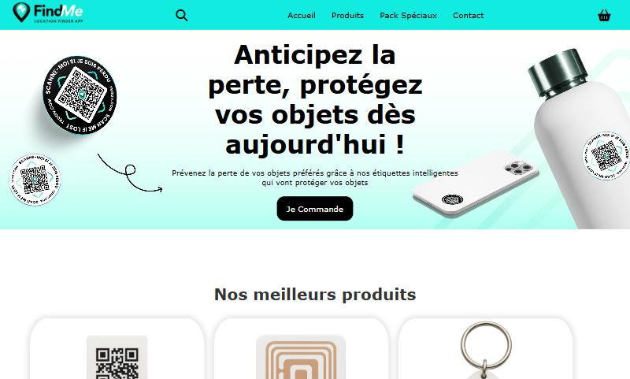
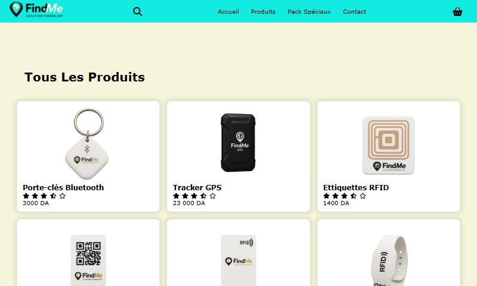
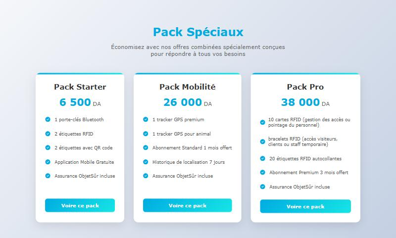

<div align="center">

# 📍 FindMe — Objets perdus, objets trouvés !

**Site vitrine et boutique en ligne d'une startup de traceurs pour retrouver ses objets perdus**


**[🌐 Voir le site en ligne](https://melissameziani.github.io/FindMe/)**

</div>

---

## 📸 Aperçu



| Produits | Packs spéciaux |
|:---:|:---:|
|  |  |

---

## 🎯 Le projet

**FindMe** est une startup qui propose des **traceurs intelligents** pour ne plus perdre ses objets : clés, sacs, valises, véhicules et même animaux de compagnie.

> « Anticipez la perte, protégez vos objets dès aujourd'hui ! »

Le site présente l'entreprise et permet de **découvrir les produits, de les comparer et de les ajouter à un panier**.

## ✨ Fonctionnalités

- **Catalogue de produits** : porte-clés Bluetooth, tracker GPS (voiture, animaux, valise), étiquettes RFID, étiquettes QR code, bracelets, cartes RFID
- **Fiche détaillée** de chaque produit, dans une fenêtre : description, avantages, prix
- **Packs spéciaux** : Starter, Mobilité et Pro, avec le détail de leur contenu
- **Panier** : ajout de produits et calcul automatique du total, en JavaScript
- **Barre de recherche** et menu de navigation
- Design moderne et **responsive** (ordinateur, tablette, mobile)

## 🏗️ Structure

```
FindMe/
├── index.html        # Accueil : présentation, meilleurs produits, packs, panier
├── produit.html      # Catalogue complet des produits
├── css/
│   ├── style.css         # Styles de l'accueil
│   └── produitStyle.css  # Styles de la page produits
├── js/
│   └── carte.js      # Données des produits, fiches détaillées et panier
└── img/              # Images des produits et du site
```

## 🛠️ Technologies

- **HTML5** et **CSS3** : mise en page, animations, design responsive
- **JavaScript** (vanilla) : affichage dynamique des produits, fenêtres de détail, panier
- **Font Awesome** pour les icônes

## 🚀 Lancer le projet

Aucune installation n'est nécessaire :

- **En ligne :** [melissameziani.github.io/FindMe](https://melissameziani.github.io/FindMe/)
- **En local :** téléchargez le projet (bouton **Code**, puis **Download ZIP**) et ouvrez `index.html` dans votre navigateur.

## 👩‍💻 Autrice

**Melissa MEZIANI** — Développeuse web full stack
[GitHub](https://github.com/melissameziani) · [LinkedIn](https://www.linkedin.com/in/melissa-meziani-b0ba4b299) · [mezianimelissa37@gmail.com](mailto:mezianimelissa37@gmail.com)
